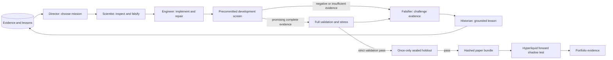

# Quant Lab v2

The fitted research and unattended-operation extension is documented in [RESEARCH_UPGRADE.md](RESEARCH_UPGRADE.md). It adds temporal model fitting, matched development benchmarks, frozen model bundles, selective recovery, and live capture status. These capabilities still require full-data and forward-performance evidence.

Measured proposal handoffs and immutable implementation tools are documented in [COMPANY_CONTRACT.md](COMPANY_CONTRACT.md). The real pilot failed its two-cycle acceptance criterion; the new safeguards passed 198 regression tests and an actual development replay, but have not yet demonstrated reliable unattended company completion.

Newly exported bundles use frozen displayed-depth IOC assumptions for Hyperliquid shadow sessions, including partial exits and shared portfolio liquidity. [DEPTH_SHADOW.md](DEPTH_SHADOW.md) records the real public-book probe, verification and the remaining gap between historical quote replay and target-venue execution.

[TASK_ALLOCATION.md](TASK_ALLOCATION.md) documents restart-proof opt-in task budgets, focused public-artifact finalization and the subsequent real scientist handoff test. That two-request test failed its specification contract; it is not evidence of reliable autonomous completion.

[SCIENTIFIC_DECISIONS.md](SCIENTIFIC_DECISIONS.md) documents the explicit proposal and evidenced-stop tools, independent mission review, immutable recovery, and separate decision/cohort accounting. Authored checks and actual metadata probes do not establish reliable real company completion.

[PROVIDER_STREAM.md](PROVIDER_STREAM.md) records bounded live response progress, safe public-draft recovery, the failed real engineering stream, and the successful small endpoint diagnostic. The corrected transport has regression and limited endpoint evidence; real engineering/company acceptance remains unproven.

Quant Lab is an evidence driven research desk for your OKX BTC perpetual L2 archive, with a common execution engine for historical replay and Hyperliquid paper trading. Agents can inspect real data, implement numerical code, run experiments, repair implementations, challenge results, and retain grounded lessons across campaigns.

The redesign replaces the active 110-persona swarm. The original source changes are backed up under `backups/before_codex_redesign`. Your `.env`, raw Drive archives, old ledger, and dossiers are preserved. Legacy approvals are not imported into the new registry.

## Run it

From PowerShell:

```powershell
Set-Location 'C:\Users\Mathis\.gemini\antigravity\scratch\quant_lab'
python -m pip install -r requirements.txt
python -m quantdesk inventory
python -m quantdesk check-provider
python -m quantdesk serve --port 8890
```

The dashboard is at **http://127.0.0.1:8890**. It shows actual agent work, experiment evidence, immutable code, candidate status, and API usage. Opening the dashboard does not start a research campaign.

For a quick infrastructure test on real data, with a clearly labeled hand-written baseline and no LLM calls:

```powershell
python -m quantdesk demo --days 12 --rows-per-day 1000
```

For a small real MiMo research campaign:

```powershell
python -m quantdesk plan --days 12 --rows-per-day 3000 --token-budget 250000
python -m quantdesk research CAMPAIGN_ID --cycles 1
python -m quantdesk status
```

Use the campaign ID printed by `plan`. Re-run `research` with the same ID to continue learning with the same frozen date plan and remaining token budget. Completed role tasks are checkpoints and are reused after a stop/restart. Each cycle normally uses five cognitive roles plus the deterministic validator. The falsifier and historian work once per submitted cohort, comparing ablations together instead of spawning another full review conversation for every variant. Identical data profiles, feature diagnostics, and strategy experiments reuse persistent evidence instead of consuming another trial. Retrieval preserves lessons even after many new feature probes. Tool calls, experiments, API usage, failures, and lessons persist in SQLite. API outages stop the campaign and never manufacture research outputs. Provider calls have a wall-clock deadline (default 900 seconds, configurable with `research --request-timeout 900`; the completion allowance is configurable with `--max-completion-tokens`); ambiguous failures remain charged at their reservation. Finalizing a checkpoint uses exact existing candidate IDs instead of asking an agent to regenerate already tested code. Use `python -m quantdesk stop CAMPAIGN_ID` to stop after the current provider call or archive replay. An interruption preserves the unfinished candidate rather than labeling it an economic rejection. Strategy submissions and completed lesson sets close their tasks with factual artifact receipts, avoiding an extra provider call that only restates stored work.

For a full chronological research campaign:

```powershell
python -m quantdesk plan --token-budget 1000000
python -m quantdesk research CAMPAIGN_ID --cycles 3
python -m quantdesk seal CAMPAIGN_ID
```

Full days are reconstructed lazily and cached as Parquet. The first full-history validation requires reading many archives from Drive and can take substantial time. A persistent heap keeps top-of-book extraction efficient; validated numerical signals are cached across cost/latency stress replays. Partial-day experiments cannot be promoted, even when profitable. Only seal a cohort when you are satisfied with the development/validation work: its test dates are consumed once, including after an operational failure. New research must use genuinely new untouched test dates.

## How the company works



The director has a specific allocation decision, the scientist owns experiments, the engineer owns code submission, the falsifier owns criticism, and the historian owns durable lessons. Their context contains real artifacts rather than generic elite-persona prompts. Each role can spend several turns using tools. MiMo thinking is enabled and opaque reasoning context is passed back correctly during tool calls. Reasoning text and credentials are not persisted. Final decisions and evidence are persisted.

Research memory lets the organization retrieve measured experiments, code, and lessons. Its benefit to decisions and research efficiency remains unproven. It does not update MiMo's model weights. There is no claim that repeated calls inherently produce better alpha; improvement must be demonstrated by later validation and forward paper records.

Allocation now begins with measured development history constraints. The scientist must commit an immutable proposal with measured feasibility or an evidenced stop for independent review before handoff. The engineer builds an immutable draft once, revises descendants and checks/replays by exact artifact ID. Numerical checks remain separate from measured economic evidence. Failed or stopped cycles retain their checkpoints; `abandon-cycle CAMPAIGN_ID --reason '...'` explicitly changes direction while preserving evidence and charged usage.

## Strategy contract

An implementation defines `compute_signal(df)` returning one finite Polars Series in `[-1, 1]`, or 1–8 stable named bounded feature columns when `model.custom_features=true`. The trusted fitting service supports ridge, quadratic ridge and native bounded XGBoost with earlier-only temporal fitting and frozen confirmation artifacts. NumPy, Polars, and selected math operations are available. Numerical code supports causal rolling statistics, nonlinear features, interactions, filters, numerical helper functions, and finite `range(...)` loops for online estimators. Helpers cannot use decorators or default arguments; all generated execution remains timeout bounded. Strategy state and warmup reset with reconstruction segments. Paper sessions keep the complete current segment instead of silently truncating cumulative history, reset at UTC day boundaries, and halt at an explicit 100,000-row history limit. The immutable specification records a rationale, a falsification condition, execution mode, holding horizon, threshold, warmup, and lineage. Agents can inspect and reuse exact previous implementations through the artifact tools. Per-date trade logs record actual entry/exit midpoint capture, execution drag, fees, and net return in basis points. The `diagnose_execution` tool separates weak price capture from fee erosion; exploratory roles see development trades, and the independent falsifier can also inspect validation trades. Holdout trade logs are never exposed through that tool.

Generated numerical code is parsed against an allowlist, run in a separate process with a timeout and a credential-free environment, and tested at several truncated prefixes. Negative shifts, backward warmup fills, and full-sample normalizations fail when future data changes historical outputs. This is a restriction for reliable numerical research, not an operating-system security sandbox for hostile arbitrary programs.

Time is exchange time in milliseconds. Features use past observed prices at actual time horizons. Each archive must begin with a snapshot; order, timestamp, sequence, and reconstruction quality are recorded. When sequence IDs are absent, continuity is explicitly marked unverifiable. OKX quantities are contracts; research uses dimensionless ratios rather than pretending raw OKX contract counts are BTC sizes on Hyperliquid.

## What promotion requires

The date plan allocates the earliest 60% to development, the next 25% to reusable validation, and the latest 15% to a sealed holdout. Dates are frozen with size and modification metadata. Exploratory tools have no holdout access. Code and specifications are immutable and hashed; duplicate titles do not create new systems.

Baseline and stress evaluation replay each date independently. A strategy needs at least 20 validation dates and 10 holdout dates, adequate full-day coverage, at least 30 trades, positive mean net return and a positive bootstrap lower bound, enough positive dates, family-wise statistical correction, and no drawdown halt. Statistical estimates use a moving daily block bootstrap. Annualized Sharpe is reported only with at least 20 daily observations. This is not labeled DSR or probability of backtest overfitting.

The sealed cohort is frozen before test exposure. It cannot be retuned or have additional members added using the same test dates. Holdout reuse is rejected across campaign IDs. Dates previously exposed to development or validation are also ineligible as fresh holdouts in another campaign. Older campaigns without exact read records have their planned research dates conservatively quarantined from future test sets. A passed strategy receives `PAPER_READY`, which is permission to collect a forward shadow record; it is not an instruction to commit money.

## Hyperliquid dry runs

Export a candidate:

```powershell
python -m quantdesk export CANDIDATE_ID
python -m quantdesk forward-plan CANDIDATE_ID
python -m quantdesk paper 'results\desk\bundles\CANDIDATE_ID' --samples 691200
python -m quantdesk forward-assess CANDIDATE_ID
python -m quantdesk portfolio CAMPAIGN_ID
```

For a clearly labeled exploratory paper test before promotion:

```powershell
python -m quantdesk export CANDIDATE_ID --exploratory
python -m quantdesk paper 'results\desk\bundles\CANDIDATE_ID' --exploratory --samples 600
```

The default forward plan freezes the next seven complete UTC days before observation, with at least 50 closed trades, 95% daily coverage, positive compounded net return and no qualifying execution/funding failures. The 691,200-sample example permits eight days at a one-second cadence, covering the partial first day and frozen window. Actual cadence may be slower. These thresholds are allocation heuristics for paper portfolios, not proof of alpha. Plans and execution settings are immutable; use `forward-plan CANDIDATE_ID --new-window` for an explicit new future window, retaining the prior plan. Acceptance expires after 14 days. Testnet, custom fetch functions, exploratory probes, edited bundles, overlapping full-date records and incomplete coverage cannot qualify.

For a portfolio, use the directory printed by `portfolio`:

```powershell
python -m quantdesk paper 'results\desk\portfolios\PORTFOLIO_ID' --samples 3600
```

Paper trading polls Hyperliquid's public BTC L2 books every second, or slower. `--testnet` selects testnet public data. It executes locally with latency, spread crossing, fees, slippage, position limits, stale-feed checks, and drawdown halts. Strategy bundles check code, specification, and execution hashes. Portfolio manifests also carry a hash. These checks detect accidental edits; they are not cryptographic signatures proving provenance against an adversary who rewrites both content and hashes. Raw books, fills, marks, errors, and a final summary are written under `results/desk/paper`. Each completed paper session also writes a labeled forward observation into organizational memory for the next director/scientist mission. It uses no wallet, signer, or exchange order route.

Fresh bundles also freeze a separately hashed displayed-depth policy: default 10% participation per observed level and a five-basis-point sweep limit. Forward fills walk the observed levels and cancel unfilled IOC quantity. Partial exits preserve residual exposure, even at a terminal liquidation. Portfolio sleeves share one book-consumption budget. Qualified forward assessment reconciles this depth evidence; legacy quote-only observations remain exploratory. Historical OKX replay still uses a quote-based model because historical contract-to-base calibration has not been established. Displayed participation and actual impact remain uncalibrated assumptions.

The default fee assumptions are 4.5 bps taker and 1.5 bps maker per side, plus 0.5 bps extra taker slippage. These are configurable in `quantdesk/settings.py`. Your actual fee tier and execution quality may differ. Historical funding is not present in the archive and is explicitly excluded; this implementation restricts research holding horizons to five minutes, blocks new exposure close to hourly funding, and rejects promotion if a gap still caused an unmodeled funding boundary crossing. It does not certify live capital readiness.

Your archive has sampled L2 updates without identified trade prints. Queue position, executed volume, maker adverse selection, and cancellation latency cannot be recovered exactly from that data. Passive experiments use an explicit trade-through proxy and **cannot pass promotion**. Taker strategies are the first honest deployment target. Researching serious market making requires collecting trades, L2, and eventual actual order lifecycle evidence on the target venue.

## Collect target-venue evidence

Frozen captures can now be measured through `python -m quantdesk venue-captures` and `python -m quantdesk venue-study CAPTURE_ID`. Agents receive exact immutable study IDs, public trade/quote diagnostics and hypothetical depth sensitivity through tools, memory and research maps. Actual acquisition constraints and provenance are documented in [VENUE_EVIDENCE.md](VENUE_EVIDENCE.md). These studies compute no strategy PnL and grant no forward or portfolio approval.

`venue-models`, `venue-replay` and `venue-replay-read` now support retrospective formula/frozen-model research on those exact captures, with quote/depth fill comparisons and immutable economic receipts. The actual existing models remained inactive; the fixed reference hit its drawdown halt. [VENUE_REPLAY.md](VENUE_REPLAY.md) records the results, controls and remaining limitations. These are already-observed research data, not qualifying forward windows.

```powershell
python -m quantdesk collect --seconds 3600
```

The public WebSocket recorder subscribes to BTC L2 books, actual trades, and asset context (including current funding context). Raw packets and local receipt timestamps are written to `results/desk/market_data/`; summary evidence enters research memory. Trade deduplication uses `(time, coin, tid)` rather than treating `tid` as globally unique. Reconnects, book gaps, and out-of-order books are explicit. Capture is bounded to one day per invocation and does not certify complete event coverage or unlock maker promotion. Historical funding settlement and queue/execution calibration still need implementation.

## Portfolios

Portfolio formation requires historical PAPER_READY status and the exact bundle's precommitted Hyperliquid forward acceptance. Weights use aligned daily **net return streams from those forward windows**, a shrinkage covariance matrix, a 35% maximum sleeve weight, near-duplicate removal, and cash when there are too few independent sleeves. Intended members need overlapping frozen observation dates. The allocator never weights by in-sample Sharpe or signal variance. The paper runner maintains separate sleeves and an aggregate account mark. The new manifest remains PAPER_ONLY and records the formation time for a fresh portfolio dry run. Individual historical or forward acceptance does not validate the newly fitted portfolio.

Each new paper session writes source and exact member identities to `session.json`. Its final receipt binds that metadata and the completed journal with checksums. Forward assessment independently reconciles cash, positions, modeled fill prices, fees and marks from the journal and checks complete coverage of the frozen dates. These local integrity checks do not authenticate records against deliberate forgery or certify depth/impact realism. Legacy sessions without bound metadata remain observations and cannot grant forward acceptance.

## Files

| Location | Purpose |
| --- | --- |
| `quantdesk/` | Active v2 company, data, replay, validation, portfolio, CLI, dashboard |
| `results/desk/desk.sqlite3` | Durable campaigns, tasks, experiments, memory, and budget |
| `results/desk/cache/` | Versioned per-day feature Parquet and quality metadata |
| `results/desk/dossiers/` | Full code and empirical reports |
| `results/desk/bundles/` | Immutable paper strategy bundles |
| `results/desk/portfolios/` | Capped portfolio manifests |
| `results/desk/paper/` | Hyperliquid books, fills, equity, and errors |
| `results/desk/market_data/` | Public Hyperliquid L2, trades, asset context, and gaps |
| `VERIFICATION.json` | Measured verification and explicit limits |
| `AUDIT.md` | Findings, redesign decisions, measured verification, remaining work |
| `database/research_ledger.db` | Historical v1 results; not accepted as v2 evidence |

Run `python -m pytest -q` for the regression suite. `lab_runner.py` and `dashboard/server.py` launch v2. The old swarm's sprint entry point is quarantined and the old auditor cannot issue approval.

## Next research infrastructure

Operate the Hyperliquid recorder over meaningful periods; add historical funding settlements, actual depth-aware impact, contract metadata, and venue-specific feature calibration. Measure inference/routing timing and reconcile historical replay with it. Complete substantial autonomous cycles and compare memory-enabled decisions with a controlled alternative. Fitted models, temporal label purging and nested walk-forward fitting are implemented; their presence does not establish alpha or learning gains. Adding more personas alone cannot provide that evidence.

The platform is a research and paper execution foundation. It has no demonstrated profitable strategy or independently verified fund performance.
